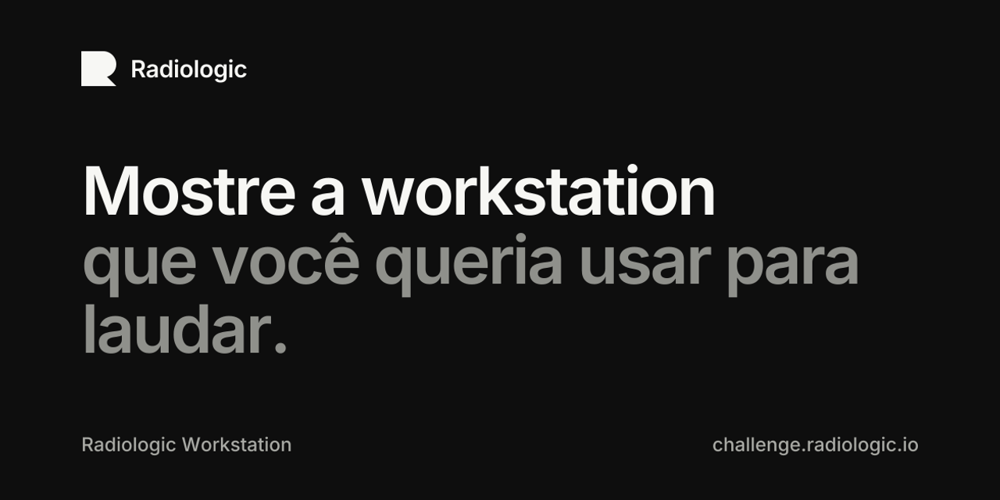

# radiologic-challenge

Site `challenge.radiologic.io`: showcase permanente e trilíngue de workstations de radiologia submetidas pelo público, com ranking por voto popular e destaques mensais.

- Arquitetura e decisões: [docs/architecture.md](docs/architecture.md)
- Instruções para agentes: [AGENTS.md](AGENTS.md)
- Rascunhos de regulamento e privacidade (PT e EN): [docs/drafts/](docs/drafts/)
- Componentes: COSS UI em `components/ui/`, sobre Base UI
- Fonte Inter 4.1 (SIL OFL 1.1): `public/fonts/` e `assets/fonts/`

## Comandos

```bash
pnpm install        # instala as dependências (pnpm-lock.yaml commitado)
pnpm dev            # servidor de desenvolvimento
pnpm lint           # eslint
pnpm typecheck      # tsc --noEmit
pnpm test:unit      # testes de unidade (Vitest)
pnpm db:test        # Supabase local e testes pgTAP, exige Docker
pnpm build          # build de produção
pnpm verify         # lint + typecheck + test:unit + build, gate do projeto
```

Mudanças entram por branch e PR para `main`. O merge publica em produção pela Vercel.

## Licença

O código deste repositório é distribuído sob a GNU Affero General Public License v3.0 (`LICENSE`).

Componentes de terceiros:

- COSS UI (`components/ui/`), Copyright (c) 2026 Cal.com, Inc., AGPL-3.0.
- Fluid Functionalism (`lib/springs.ts`), Copyright (c) 2026 Micka Touillaud, MIT (aviso completo em `THIRD_PARTY_NOTICES.md`).
- ASCII wake (`components/ascii-wake.tsx`), Copyright (c) 2026 Lorenzo Cabra, MIT (aviso no arquivo).
- Inter (`public/fonts/`, `assets/fonts/`), SIL Open Font License 1.1 (`assets/fonts/OFL.txt`).
